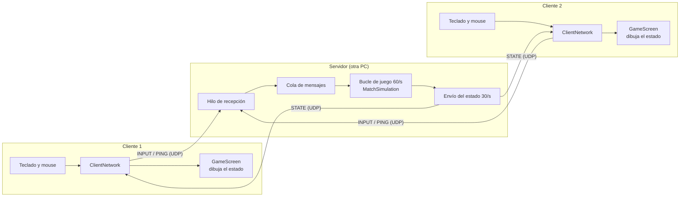
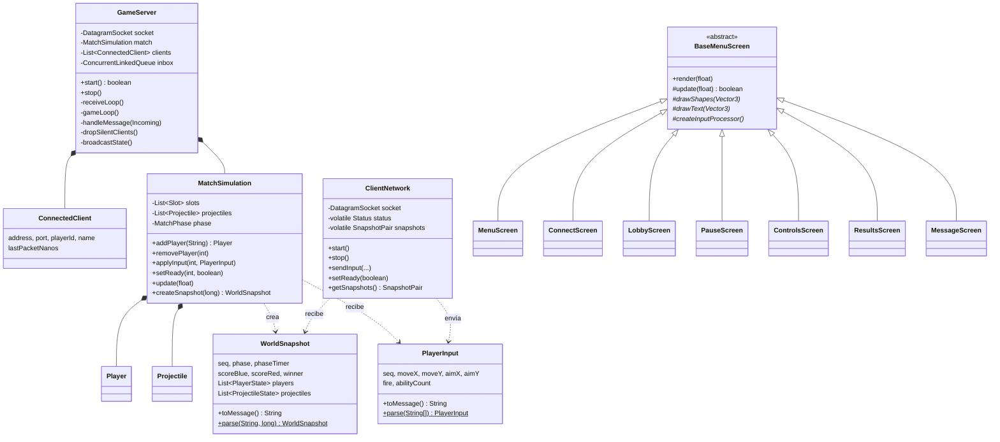

# Arquitectura de red — OverZone

Este documento explica cómo funciona la parte de red del juego: quién hace qué, qué mensajes se envían, cómo se manejan los retardos y los errores, y cómo se cumple cada requisito técnico de aprobación.

## 1. Idea general



* El **servidor** es el único que tiene la partida real (`MatchSimulation`). Recibe entradas, simula y envía el resultado.
* Los **clientes** envían entradas y dibujan lo que reciben. Un cliente nunca decide si un disparo pegó, ni cuánta vida tiene alguien, ni quién ganó.

Así, todos los clientes ven la misma partida: no puede haber dos clientes con resultados distintos, porque el resultado lo calcula uno solo.

### Dos repositorios

| Repositorio | Contiene |
| --- | --- |
| `OverZoneScardaoni` (cliente) | Pantallas, gráficos, audio, entrada y `ClientNetwork`. **No** contiene la lógica de la partida. |
| `OverZoneScardaoni-Server` (servidor) | `GameServer`, `ConnectedClient`, `ServerLauncher` y, en `server.game`, `MatchSimulation`, `Player` y `Projectile`. |
| Los dos (paquete `shared`) | `Protocol`, `PlayerInput`, `WorldSnapshot`, `MatchPhase`, `Team`, `Direction`, `CharacterType`, `GameConstants`, `Arena`, `Obstacle`. |

El paquete `shared` está copiado en los dos repositorios y tiene que ser idéntico en ambos. Para que una diferencia no pase desapercibida, el cliente envía `Protocol.VERSION` al conectarse: si no coincide con la del servidor, la conexión se rechaza (`REJECT;VERSION`) y el cliente muestra qué versión tiene cada uno.

## 2. Hilos

| Programa | Hilo | Qué hace |
| --- | --- | --- |
| Servidor | Recepción (`ServerReceive`) | Espera paquetes UDP (`socket.receive`, bloqueante) y los deja en una cola segura (`ConcurrentLinkedQueue`). |
| Servidor | Bucle de juego (`ServerGameLoop`) | 60 veces por segundo: procesa la cola, desconecta clientes en silencio, avanza la partida y, cada dos vueltas, envía el estado. Es el **único** hilo que toca la partida, así que no hay dos hilos modificándola a la vez. |
| Servidor | Principal | Lee comandos de la consola (`estado`, `retardo`, `perdida`, `normal`, `salir`). |
| Cliente | Dibujo (LibGDX) | Lee teclado y mouse, envía `INPUT` y dibuja. |
| Cliente | Red (`ClientNetwork`) | Busca el servidor, se conecta, recibe estados, envía `PING` cada 250 ms y detecta si se perdió la conexión. |

Los datos que comparten los dos hilos del cliente se guardan en variables `volatile` y en objetos que no cambian después de creados (`WorldSnapshot`): el hilo de red arma una foto nueva y la reemplaza entera; el hilo de dibujo nunca ve una foto a medio armar.

## 3. Mensajes

Todos son texto con los campos separados por `;`. Los números con decimales siempre se escriben con **punto** (`Protocol.f`): con la configuración regional de Argentina, `String.format` escribiría `12,5` y la coma rompería el mensaje.

| Mensaje | Sentido | Para qué |
| --- | --- | --- |
| `OVERZONE_DISCOVER` | Cliente → todos (broadcast) | ¿Hay un servidor en la red? |
| `OVERZONE_SERVER;nombre;jugadores;max;version` | Servidor → cliente | Respuesta al broadcast. Si la versión no coincide, el cliente avisa y no se conecta. |
| `CONNECT;nombre;version` | Cliente → servidor | Pedido para unirse. Se reintenta cada 500 ms. |
| `WELCOME;id` | Servidor → cliente | Aceptado; se le asigna un número de jugador. |
| `REJECT;FULL` / `REJECT;UNKNOWN` / `REJECT;VERSION;v` | Servidor → cliente | Partida llena / el servidor no conoce a este cliente / versión de protocolo distinta. |
| `INPUT;seq;moveX;moveY;aimX;aimY;fire;contadorHabilidad` | Cliente → servidor | Entradas del jugador, una por frame. |
| `PING;listo;personaje;modo;marcaDeTiempo` | Cliente → servidor | Latido cada 250 ms; además informa si el jugador marcó "listo", qué personaje eligió y qué modo pide. El servidor solo acepta el personaje en la sala de espera, y el modo solo si lo pide el anfitrión y se puede jugar con los jugadores que hay. |
| `PONG;marcaDeTiempo` | Servidor → cliente | Devuelve la marca: el cliente calcula el retardo de ida y vuelta. |
| `STATE;seq;fase;tiempo;azul;rojo;ganador;motivo;modo;anfitrion;JUGADORES;PROYECTILES;ZONAS` | Servidor → clientes | Estado completo de la partida, 30 veces por segundo. Incluye el modo, quién es el anfitrión y los Campos de Regeneración de Iris. |
| `DISCONNECT` | Cliente → servidor | Me voy (se envía dos veces). |
| `SHUTDOWN` | Servidor → clientes | El servidor se cierra (se envía dos veces). |

### Conexión

```mermaid
sequenceDiagram
    participant C as Cliente
    participant S as Servidor
    C->>S: OVERZONE_DISCOVER (broadcast a toda la subred)
    S-->>C: OVERZONE_SERVER;OverZone;1;4;3
    C->>S: CONNECT;Facu;3
    S-->>C: WELCOME;2
    loop Cada 250 ms
        C->>S: PING;0;1;0;marca
        S-->>C: PONG;marca
    end
    loop 30 veces por segundo
        S-->>C: STATE;...
    end
    loop Cada frame, durante la partida
        C->>S: INPUT;...
    end
```

## 4. Etapas de la partida

```mermaid
stateDiagram-v2
    [*] --> LOBBY
    LOBBY --> COUNTDOWN : todos listos (Todos contra todos: 2 o más; Equipos: 4)
    COUNTDOWN --> LOBBY : alguien deja de estar listo o se va
    COUNTDOWN --> PLAYING : 3 segundos
    PLAYING --> RESULTS : tiempo agotado
    PLAYING --> RESULTS : no quedan rivales (un equipo vacío o 1 solo jugador)
    RESULTS --> LOBBY : 8 segundos (nadie listo)
```



La etapa viaja dentro de cada `STATE`. Los clientes no cambian de pantalla por su cuenta: `Main.followServer` compara la etapa recibida con la pantalla actual y cambia cuando no coinciden (sala → juego → resultados → sala).

### Modos de juego y anfitrión

* El **anfitrión** es el primer jugador de la lista del servidor (el que lleva más tiempo conectado). Si se va, el siguiente pasa a ser anfitrión. Su id viaja en cada `STATE`, así todos los clientes saben quién es.
* El cliente manda en cada `PING` el modo que pide. El servidor **solo reacciona cuando el pedido cambia**, y lo aplica si: viene del anfitrión, la partida no empezó y el modo se puede jugar (Equipos 2v2: exactamente 4 jugadores). Si no, lo ignora y el estado sigue mostrando el modo actual.
* Si estando en Equipos alguien se va de la sala, el servidor vuelve a Todos contra todos.
* El campo `team` de cada jugador significa cosas distintas según el modo: en Equipos es el equipo (0 azul, 1 rojo); en Todos contra todos, el color propio de cada jugador (0 a 3). El campo `ganador` es el equipo o el id del jugador ganador (-1 si hay empate).

### Habilidades sincronizadas por el servidor

* **Campo de Regeneración (Iris):** el servidor crea la zona (`RegenZone`), le descuenta el tiempo y en cada paso cura a los aliados que están adentro. Viaja en la lista `ZONAS` del estado; el cliente solo la dibuja.
* **Camuflaje Óptico (Phantom):** el servidor marca a Phantom con la habilidad activa (y la corta si dispara). Cada cliente decide cómo dibujarlo según si es rival o aliado, pero todos parten del mismo dato, así que ven el mismo efecto al mismo tiempo.

## 5. Retardos y pérdida de paquetes (requisito 3)

| Problema | Cómo se resuelve |
| --- | --- |
| Un `STATE` se pierde | El siguiente trae el estado completo y lo reemplaza. |
| Un `STATE` llega después de uno más nuevo | Se descarta por su número de secuencia. |
| Un `INPUT` llega tarde | El servidor lo descarta si su número es menor al último aplicado. |
| Se pierde el `INPUT` que pedía la habilidad | El contador de habilidad viaja en todos los `INPUT`; el siguiente igual informa el pedido. |
| Dejan de llegar entradas de un jugador (pausa, red cortada) | A los 0,25 s el servidor lo deja quieto y sin disparar, en lugar de repetir la última orden. |
| Los estados llegan "a saltos" | El cliente dibuja a cada jugador en un punto intermedio entre los dos últimos estados (interpolación), así el movimiento se ve continuo. |

Para comprobarlo, la consola del servidor permite simular una red mala: `retardo 150` agrega 150 ms en cada sentido y `perdida 20` descarta el 20 % de los paquetes. El HUD muestra el retardo medido (ping).

## 6. Situaciones de error (requisito 5)

| Situación | Qué pasa |
| --- | --- |
| Puerto ocupado | El servidor muestra "el puerto 5555 ya está en uso" y termina (código de salida 1). |
| No hay servidor | El cliente reintenta el broadcast 5 veces y muestra "No se encontró ningún servidor", con opción de reintentar. |
| Partida llena | El servidor responde `REJECT;FULL` y el cliente lo informa. |
| Cliente y servidor de versiones distintas | El cliente muestra la versión de cada uno y no se conecta. |
| Un cliente cierra el juego | Envía `DISCONNECT`; el servidor lo saca de la partida. |
| Un cliente se cuelga o se corta la red | El servidor no recibe nada durante 3 s y lo desconecta. Si un equipo queda vacío, la partida termina. |
| El servidor se cierra (`salir` o Ctrl+C) | Envía `SHUTDOWN`; los clientes muestran "El servidor se cerró" y vuelven al menú. |
| El servidor se cae sin avisar | Los clientes no reciben nada durante 3 s y muestran "Se perdió la conexión". |
| El servidor se reinicia | Si un cliente viejo le envía datos, responde `REJECT;UNKNOWN`; el cliente lo informa y puede volver a conectarse. |
| Cierre de hilos y sockets | Cliente: el hilo de red es *daemon* y `stop()` cierra el socket. Servidor: `stop()` avisa a los clientes, cierra el socket (lo que desbloquea al hilo de recepción) y espera que los hilos terminen. No queda ningún proceso abierto. |
| Mensaje mal formado | Se ignora; no cierra ni el servidor ni el cliente. |

## 7. Requisitos de aprobación

| Requisito | Dónde se cumple |
| --- | --- |
| 1. Juego en red con 2 clientes y servidor en otra PC | Servidor en un repositorio y programa propios; clientes en cualquier PC de la subred. |
| 2. Cliente-servidor con lógica en el servidor | `MatchSimulation` existe solo en el repositorio del servidor: el cliente ni siquiera tiene ese código. Los clientes envían `INPUT` y dibujan `STATE`. |
| 3. Retardos y sincronización | Sección 5. |
| 4. Box2D | No se usa. Las colisiones son rectángulos calculados en el servidor. |
| 5. Errores de red | Sección 6. |
| 6. Reinicio de partidas | `RESULTS → LOBBY` automático; se juega otra partida sin reiniciar programas. |
| 7. Broadcast | `ClientNetwork.sendDiscovery`: envía a `255.255.255.255`, a la dirección de broadcast de cada placa de red y a la propia PC. No hay IP escrita en el código. |

## 8. Clases nuevas



## 9. Cómo probar

1. **Una sola PC:** abrir el servidor y dos clientes. Marcar "Listo" en ambos.
2. **Red LAN:** servidor en una PC y un cliente en cada una de otras dos, todas en la misma subred.
3. **Retardo:** en la consola del servidor, `retardo 150` y `perdida 20`; el juego sigue siendo consistente y el ping del HUD sube. `normal` lo vuelve a la normalidad.
4. **Desconexiones:** cerrar un cliente con la X, cerrar un cliente desde el Administrador de tareas, escribir `salir` en el servidor, cerrar la consola del servidor, desconectar el cable o el Wi-Fi de un cliente.
5. **Puerto ocupado:** abrir un segundo servidor en la misma PC.
6. **Revancha:** terminar una partida y, desde la sala, jugar otra sin cerrar nada.
