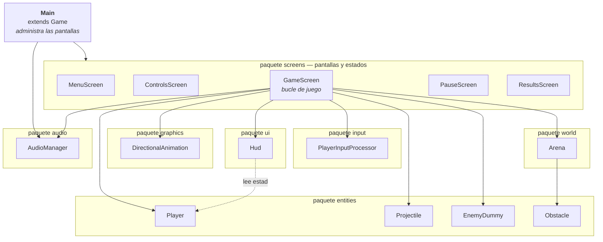
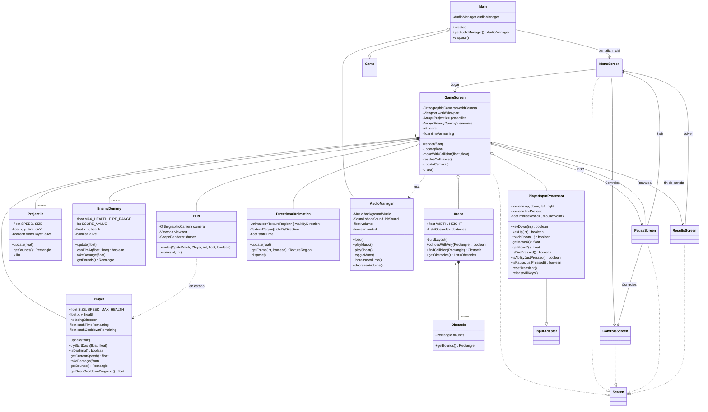
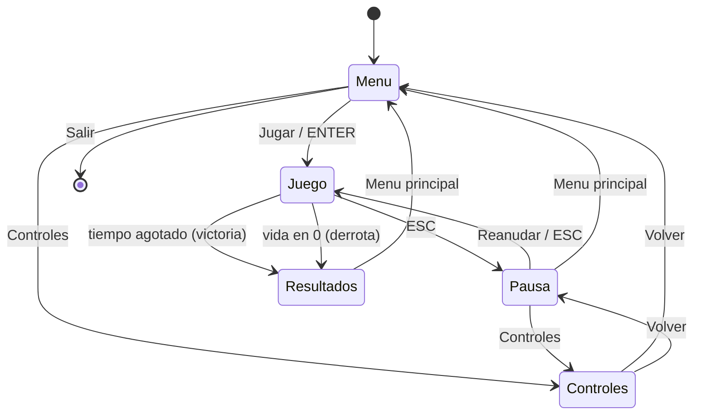

# Diagrama de clases y paquetes — OverZone (prototipo)

Este documento describe la organización interna del código del prototipo entregado en la segunda pre-entrega. El objetivo de esta estructura es que cada clase tenga **una única responsabilidad clara**, de modo que la capa de red (Cliente-Servidor, TCP/UDP) pueda integrarse en la siguiente etapa sin reescribir la lógica de juego.

## 1. Vista general por paquetes

## 2. Diagrama de clases

## 3. Flujo de pantallas (máquina de estados)

## 4. Responsabilidad de cada clase

| Paquete | Clase | Responsabilidad | Punto de la consigna |
| --- | --- | --- | --- |
| *(raíz)* | `Main` | Extiende `Game`. Crea el `AudioManager` y administra qué `Screen` está activa. | 5 |
| `input` | `PlayerInputProcessor` | Extiende `InputAdapter`. Traduce teclado y mouse en un estado consultable. No contiene lógica de juego. | 1 |
| `entities` | `Player` | Posición, vida, dirección, invulnerabilidad y habilidad "Impulso Over" con cooldown. | 1, 6 |
| `entities` | `Projectile` | Proyectil con dirección y velocidad; sabe si lo disparó el jugador o un enemigo. | 6 |
| `entities` | `EnemyDummy` | Enemigo tipo torreta: dispara por proximidad, recibe daño, muere y reaparece. | 6 |
| `entities` | `Obstacle` | Área rectangular sólida del entorno. | 3, 6 |
| `world` | `Arena` | Construye el entorno (paredes y cobertura), responde consultas de colisión y valida los puntos de aparición. | 3, 6 |
| `graphics` | `DirectionalAnimation` | Divide el spritesheet con `TextureRegion.split` y arma un `Animation` por dirección, administrando el `stateTime`. | 2 |
| `audio` | `AudioManager` | Carga y reproduce `Music` y `Sound`; controla volumen y silenciado. | 8 |
| `ui` | `Hud` | Interfaz fija con cámara y `Viewport` propios: vida, habilidad, puntaje, tiempo y sonido. | 7 |
| `screens` | `GameScreen` | Bucle de juego: actualiza entidades, resuelve colisiones, mueve la cámara y dibuja. | 1-8 |
| `screens` | `MenuScreen` | Pantalla inicial con las opciones Jugar, Controles y Salir. | 5 |
| `screens` | `ControlsScreen` | Lista de controles; vuelve a la pantalla desde la que fue invocada. | 5 |
| `screens` | `PauseScreen` | Congela la partida sin destruirla; permite reanudar, ver controles o salir. | 5 |
| `screens` | `ResultsScreen` | Muestra victoria o derrota junto al puntaje final. | 5 |

## 5. Decisiones de diseño

- **`Main` extiende `Game` y no `ApplicationAdapter`**, porque `Game` provee el mecanismo de `setScreen()` necesario para cambiar de pantalla sin reiniciar la aplicación.
- **El `AudioManager` vive en `Main`, no en `GameScreen`**, para que la música siga sonando de forma continua al pasar entre pantallas y no se recargue cada vez.
- **`PauseScreen` recibe el `GameScreen` por referencia** en lugar de crear uno nuevo, de modo que la partida (posición, vida, puntaje, tiempo) se conserve intacta al reanudar.
- **El HUD usa un `Viewport` separado** del mundo: si compartiera la cámara del juego, la interfaz se desplazaría junto con el jugador.
- **Las colisiones se resuelven eje por eje** (primero X, después Y). Así, al chocar en diagonal contra una pared, el personaje se desliza sobre ella en vez de quedarse trabado.
- **La velocidad diagonal se normaliza**: sin esa corrección, moverse en diagonal sería aproximadamente un 41% más rápido que hacerlo en línea recta.
- **La arena valida los puntos de aparición** (`findFreeSpawn`) en lugar de confiar en coordenadas escritas a mano. Al haber un obstáculo justo en el centro, el jugador aparecía dentro de él y el sistema de colisiones lo dejaba inmovilizado; la validación hace que ese error sea imposible de repetir al cambiar el layout.
- **La música sigue sonando durante la pausa**, porque es donde está la barra de volumen: sin sonido, el usuario no tendría forma de escuchar el efecto de lo que ajusta.
- **`EnemyDummy` es temporal**: existe para demostrar la mecánica de combate (disparar, impactar, eliminar, puntuar) mientras la sincronización multijugador no está implementada. En la etapa de red, su lugar lo ocuparán los jugadores remotos.
